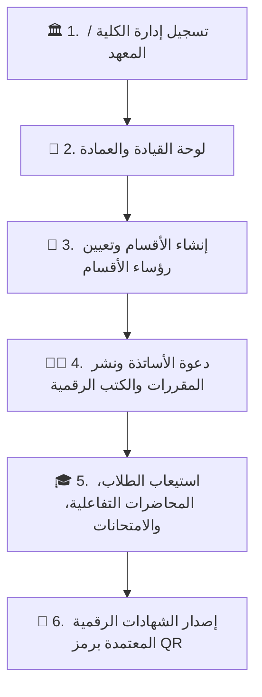
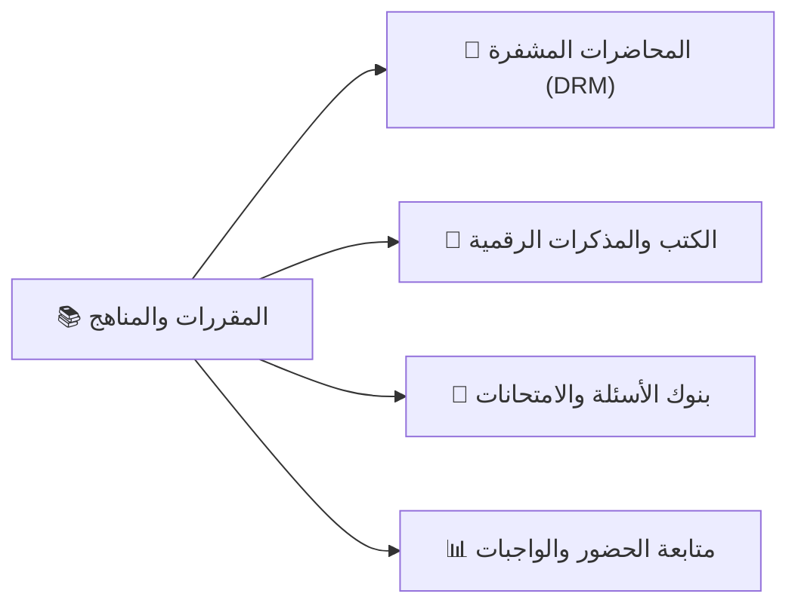

# 🏛️ كتالوج ودليل تشغيل منظومة UNIGATES الجامعية الموحدة
### الدليل الشامل لعمداء الكليات، رؤساء الأقسام، أعضاء هيئة التدريس، والطلاب

---

## 🌟 نظرة عامة على المنظومة
تُعد منصة **UNIGATES** النظام الأكاديمي والتعليمي الرقمي الموحد لإدارة وتشغيل الكليات الجامعية والمعاهد العليا، حيث توفر بيئة سحابية فائقة الأمان تجمع بين **الإدارة الأكاديمية الشاملة**، **بث المحاضرات المشفرة بتقنية DRM**، **حماية الملكية الفكرية للكتب الرقمية**، ونظام **المساحات الإيجارية المرنة بالكريدت**.



---

## 📋 الفهرس التنفيذي للكتالوج:
1. [البوابة الأولى: تسجيل المؤسسة الأكاديمية ونظام المساحات الإيجارية (الكريدت)](#1-البوابة-الأولى-تسجيل-المؤسسة-الأكاديمية)
2. [البوابة الثانية: لوحة تحكم إدارة الكلية والعمادة (College Leadership Hub)](#2-لوحة-تحكم-إدارة-الكلية-والعمادة)
3. [البوابة الثالثة: لوحة تحكم رئيس القسم وعضو هيئة التدريس (Department Head & Faculty)](#3-لوحة-تحكم-رئيس-القسم-وعضو-هيئة-التدريس)
4. [البوابة الرابعة: بوابة وطالب الكلية (Student Academic Portal)](#4-بوابة-وطالب-الكلية)
5. [البوابة الخامسة: استوديو المنتجات التعليمية والكتب والمحاضرات الرقمية](#5-استوديو-المنتجات-التعليمية-والمقررات)
6. [البوابة السادسة: الإدارة المالية، تسوية الأرباح، وحماية الطلاب](#6-الإدارة-المالية-وحماية-المنظومة)

---

## 1. 🏛️ البوابة الأولى: تسجيل المؤسسة الأكاديمية

### 🚪 أ. واجهة اختيار نوع المؤسسة (`/signup`)
مخصصة للتعليم العالي فقط، وتتيح الاختيار بين:
* **إدارة كلية جامعية:** لتسجيل كليات الجامعات الحكومية والخاصة والأهلية.
* **إدارة معهد عالي:** لتسجيل المعاهد الأكاديمية والهندسية والتجارية العليا.


### 📝 ب. نموذج التسجيل المتكامل (5 خطوات ذكية):
1. **بيانات الكلية والجامعة:** اسم الكلية، اسم الجامعة التابعة، اسم العميد، المدينة، والعنوان التفصيلي للحرم.
2. **الشعار الرسمي والهوية البصرية:** رفع الشعار المعتمد لاستخدامه في ترويسات الاختبارات الرسمية والشهادات.
3. **الهيكل الأكاديمي والسعة التقديرية:** تحديد عدد الأقسام العلمية وعدد الطلاب المتوقع.
4. **المساحة الإيجارية وسعة الطلاب (الكريدت السحابي):**
   * 🎁 **هدية ترحيبية فورية:** **20 كريدت سحابي مجاناً** لاستيعاب أول 20 طالباً لمدة 30 يوماً بدون أي رسوم.
   * **تسعير المقاعد الإضافية:** **\$1.20** لكل مقعد إضافي (1 كريدت).
   * **ميزة الترحيل (Rollover):** الرصيد غير المستخدم يُرحّل للشهر التالي تلقائياً.
5. **بيانات حساب المسؤول المعتمد:** البريد الرسمي، الهاتف، وكلمة المرور المشفرة.


---

## 2. 👑 لوحة تحكم إدارة الكلية والعمادة

تُمثل لوحة تحكم الكلية مركز القيادة والتحكم الإداري والأكاديمي والمالي:

```
┌─────────────────────────────────────────────────────────────────────────────────┐
│                          لوحة عمادة الكلية (Dean Dashboard)                     │
├─────────────────┬───────────────────┬─────────────────────┬─────────────────────┤
│ 👥 إجمالي الطلاب│ 🏢 الأقسام العلمية │ 👨‍🏫 الكادر التدريسي  │ 💳 رصيد الكريدت     │
│      3,850      │       8 أقسام     │      124 عضواً      │     1,200 مقعد      │
└─────────────────┴───────────────────┴─────────────────────┴─────────────────────┘
```

### 🛠️ الوظائف الرئيسية لإدارة الكلية:
* **إدارة الهيكل الأكاديمي والأقسام:** إنشاء الأقسام العلمية (مثل: قسم علوم الحاسب، قسم الهندسة المدنية، قسم إدارة الأعمال) وتعيين رؤساء الأقسام.
* **إرسال الدعوات والأكواد المشفرة:** توليد روابط دعوة خاصة بوكلاء الكلية، رؤساء الأقسام، وأعضاء هيئة التدريس ليتم ربط حساباتهم بالكلية فور التسجيل الداخلي.
* **إدارة المحفظة والمساحات الإيجارية:** شحن رصيد الكريدت، متابعة السعة المستخدمة والمتبقية، والاطلاع على الفواتير الضريبية.
* **الاعتماد والتقارير:** مراقبة جداول المحاضرات، نسب حضور الطلاب، والنتائج العامة للاختبارات.

---

## 3. 💼 لوحة تحكم رئيس القسم وعضو هيئة التدريس

لوحة متطورة ومخصصة لإدارة المقررات الدراسية وتدريس المادة العلمية:



### 🎯 أبرز مميزات حساب رئيس القسم والمحاضر:
1. **استوديو المحاضرات المشفرة (DRM Video Hub):**
   * رفع محاضرات الفيديو بجودة 4K مع تشفير فوري 256-bit لمنع تصوير الشاشة أو تنزيل الفيديو خارج التطبيق.
2. **الكتب والمذكرات التفاعلية (E-Books):**
   * إتاحة المذكرات والمراجع العلمية المقررة مع **علامة مائية ديناميكية** تحمل اسم ورقم هاتف الطالب لمنع تسريب المذكرات.
3. **قاعات البث المباشر التفاعلية (Live Classrooms):**
   * بث محاضرات حية مع سبورة ذكية، محادثة فورية، وإمكانية تسجيل المحاضرة وأرشفتها تلقائياً.
4. **بنوك الأسئلة والاختبارات التلقائية:**
   * إنشاء اختبارات دورية، نصفية، ونهائية بنماذج تصحيح ذكية وإظهار مباشر للنتائج والدرجات.
5. **إدارة التكليفات والواجبات:**
   * استلام الواجبات وتصحيحها ورصد الدرجات والملاحظات للطالب مباشرة.

---

## 4. 🎓 بوابة وطالب الكلية

واجهة عصرية توفر للطالب تجربة تعليمية جامعية متكاملة وممتعة:

### 🌟 الميزات التي يحصل عليها الطالب:
* **الجدول الدراسي الذكي:** جدول المحاضرات الأسبوعي، ومواعيد البث المباشر، وتنبيهات مواعيد تسليم التكليفات.
* **مشاهدة المحاضرات 4K السحابية:** مشغل فائق السرعة يدعم تسريع الفيديو، وجودات متعددة، وملاحظات أثناء الشرح.
* **المكتبة الرقمية التفاعلية:** قارئ كتب رقمي مدمج داخل المنصة يدعم التظليل، تدوين الملاحظات، والبحث السريع.
* **غرفة الامتحانات الذكية:** بيئة آمنة لخوض الامتحانات مع مؤقت زمني ومنع الغش.
* **سجل الدرجات والشهادات الرقمية:** كشف حساب أكاديمي فوري بالدرجات والتقديرات مع إمكانية استخراج الشهادات الموثقة برمز QR.

---

## 5. 🛍️ استوديو المنتجات التعليمية والمقررات

يتيح لأعضاء هيئة التدريس وإدارة الكلية طرح المقررات والمراجع بأساليب مرنة:

| نوع المنتج | التوصيف والمميزات | نظام الحماية المطبق |
| :--- | :--- | :--- |
| **🎥 مادة / دورة مسجلة 4K** | محاضرات فيديو شاملة مجزأة لفصول ووحدات | تشفير DRM + منع التقاط الشاشة |
| **📚 كتاب / مذكرة رقمية** | كتاب تفاعلي للقراءة داخل المنصة مع فهرس ذكي | علامة مائية ديناميكية (Dynamic Watermark) |
| **🔴 ورشة وبث مباشر** | لقاءات تفاعلية حية مع الطلاب واستقبال الأسئلة | وصول مشفر للمسجلين فقط |
| **✨ باقة شاملة (Bundle)** | حزمة تجميعية (المحاضرات + الكتاب + شهادة QR) | حماية مزدوجة لكافة المحتويات |

---

## 6. 🛡️ الإدارة المالية وحماية المنظومة

### 💰 أ. آلية التسوية المالية واستلام الأرباح:
* **عمولة المنصة:** **5% فقط** في حال انضمام الطلاب من المنصة العامة، مع استلام المحاضر لـ **100% من أرباح طلاب كليته ومجموعاته الخاصة**.
* **سحب الأرباح:** تحويل بنكي مباشر (IBAN)، محافظ الهاتف (InstaPay / Vodafone Cash / STC Pay)، أو PayPal.

### 🔒 ب. نظام الضمان والأمان الأكاديمي (Escrow Guarantee):
* **فترة حجز مؤقت (Holding Period):** لحماية الطلاب من أي إخلال بالمحتوى الدراسي.
* **ضمان استرداد الأموال:** إعادة الرسوم فوراً للطالب في حال ثبوت عدم التزام المحاضر بخطة المنهج المقررة.
* **توثيق الكوادر (KYC):** التحقق من هويات الأساتذة والشهادات الأكاديمية قبل اعتماد الحسابات وسحب الأرباح.

---

> [!NOTE]
> هذا الكتالوج يمثل التوثيق الأكاديمي والتقني الكامل لمنظومة **UNIGATES**، ويمكن استخدامه كمرجع رسمي لتدريب منسوبي الجامعات والكليات ومراكز التدريب.
